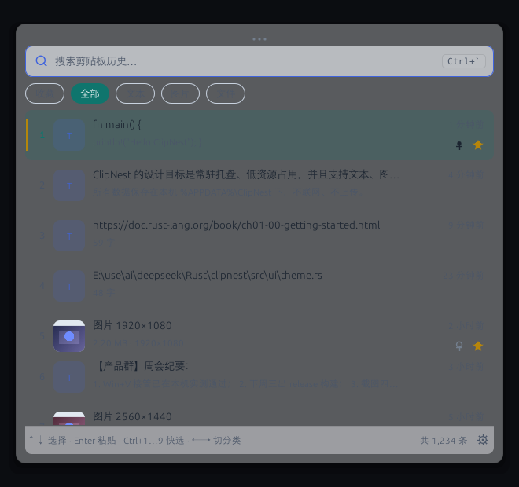
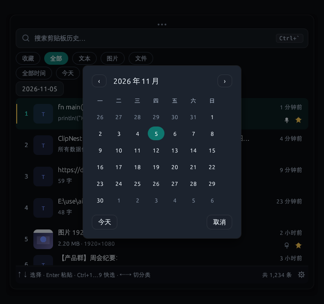
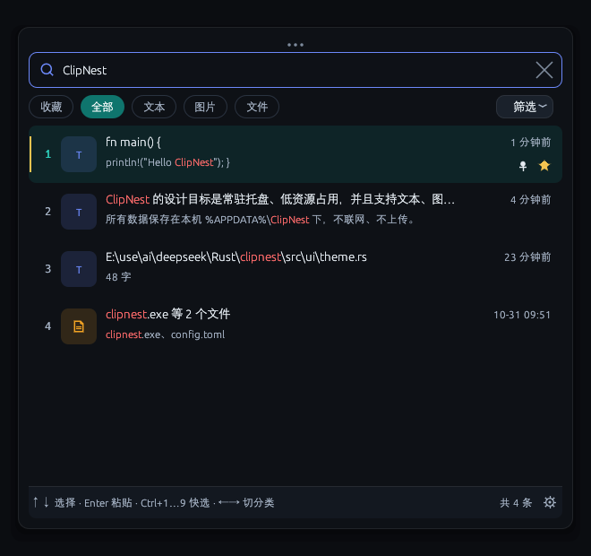
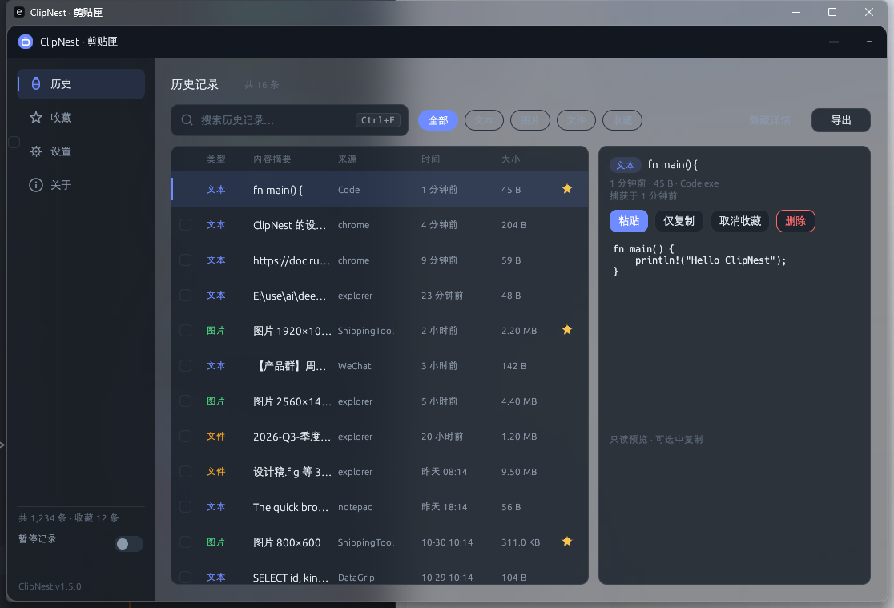
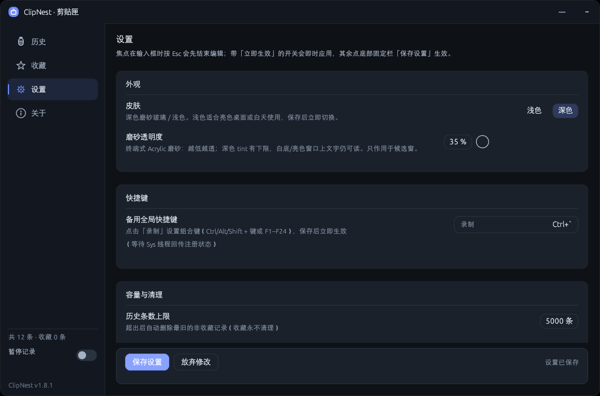
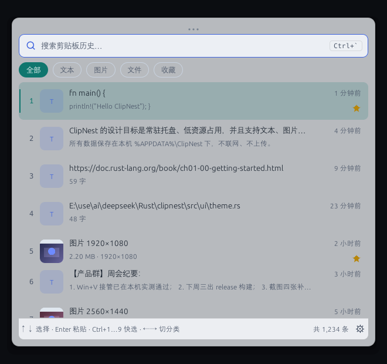
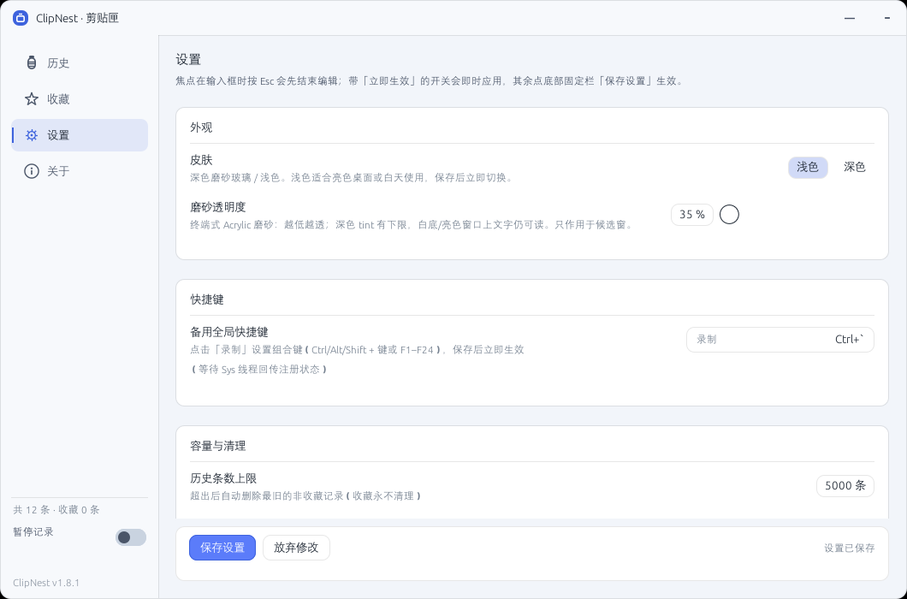
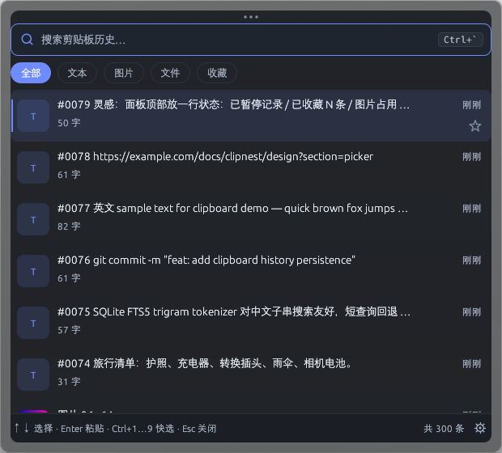

# ClipNest · 剪贴匣

[](https://github.com/rosefinchlj/clipnest/releases) [](LICENSE)

> Windows 磨砂玻璃剪贴板管理器（深色 / 浅色）。Rust + eframe/egui 实现：托盘常驻、全局快捷键呼出候选窗、文本/图片/文件历史持久化、收藏与容量治理、选中即自动粘贴回原窗口。

> **下载**：[Releases](https://github.com/rosefinchlj/clipnest/releases) 提供最新单文件绿色 exe（Windows 10 1809+ / 11，免安装、不写系统目录）。
> 本项目同时作为 **Rust 实践学习项目** 开源：Win32 系统编程 + eframe/egui 界面 + SQLite 持久化的完整实现，保留设计与验收文档。
> 在线介绍页：[rosefinchlj.github.io/clipnest](https://rosefinchlj.github.io/clipnest/)

## 这是什么

**ClipNest（剪贴匣）是一个 Windows 剪贴板历史管理器 / 剪贴板工具**：把你 Ctrl+C 复制过的文本、图片、文件自动记进本地数据库，
按全局快捷键呼出可搜索的候选窗，选中即粘贴回原窗口。单文件绿色 exe，纯本地、不联网，Rust + eframe/egui 实现。

**ClipNest is a clipboard history manager for Windows.** It records copied text, images and files into a local SQLite database,
opens a searchable picker with a global hotkey, and pastes the selected entry right back into the window you came from.
Single portable `.exe` for Windows 10/11, fully offline, built in Rust (eframe/egui + SQLite).

常见搜索词 / commonly searched as：Windows 剪贴板历史、剪贴板管理器、剪贴板工具、复制粘贴历史、clipboard history Windows、clipboard manager。
可替代 / alternatives：Windows 自带 `Win+V` 剪贴板历史、Ditto、CopyQ、ClipClip（差异见下方 [FAQ](#faq)）。








| 管理台 · 历史 | 管理台 · 设置（深色） |
|---|---|
|  |  |

| 浅色皮肤 · 候选窗 | 浅色皮肤 · 设置 |
|---|---|
|  |  |

## 为什么重新造一个

现有剪贴板工具常见问题：侧栏常驻占屏、界面粗糙、内存占用偏高（100MB+）、历史容量不可控。
ClipNest 的目标是**低占用、键盘优先、视觉克制**：

- 纯 Rust，无 WebView；**单进程常驻并预先创建窗口**，按快捷键秒开（实测 20–80ms）；
  内存约 57MB Private（v1.2 按用户要求暂不再做低内存优化）；
- 托盘常驻，默认**不占任务栏**；按快捷键在光标屏幕中央弹出候选窗，选完即粘贴回原窗口；
- Ctrl+C 即入库，SQLite 持久化，重启/关机不丢；默认 5000 条 / 图片 200MB，可调、可改无限；
- 文本、图片（截图）、文件列表三类内容都支持；文件默认只记路径，**收藏时**才复制实体进库；
- **深色 / 浅色两套皮肤**（设置 → 外观切换，保存后立即生效）；**磨砂透明度 35–100% 可调**（终端式 Acrylic 模糊，越低越透但深色 tint 有下限，白底/亮色桌面也清晰）；
- 搜索框下方提供**时间范围**筛选：默认收起，点「筛选」展开；可选全部时间 / 今天 / 近7天 / 近30天 / 近90天，再点「指定日期」用日历选择任意一天或一个日期范围，按最近使用时间快速收窄列表；
  面板**跟随光标定位**，靠近屏幕下/上边缘时自动上翻/下翻、始终不超出视窗；
  托盘图标按 DPI 预渲染，16px 也清晰；顶部拖拽条/管理台标题栏可按住拖动窗口。

## 功能

- **采集**：监听系统剪贴板（Ctrl+C / 右键复制 / 截图工具），自动去重、最近置顶，记录来源应用；同时保留**富文本 HTML/RTF**，粘贴到 Word/浏览器/邮件时尽量保留链接、加粗、表格等格式，失败自动降级纯文本。
- **候选窗**：全局快捷键呼出；输入即搜（FTS5 trigram，中文子串友好，**命中关键字标红**）；支持**多关键词**（任一 / 全部）、**来源应用筛选**与**排序**（最近/最早/最大/类型/使用最多）；`↑↓` 选择、`Enter` 粘贴、`Ctrl+Enter` 仅复制、`Ctrl+1…9` 快选、`Ctrl+F` 随时聚焦搜索框、`Tab` / `←→` 切过滤（收藏 → 全部 → 文本 → 图片 → 文件，默认全部）、`Ctrl+P` 收藏、`Delete` 移入回收站、`Esc` 关闭。
- **选中预览**：候选窗用 `↑↓` 或鼠标选中图片、长文本时，弹出带淡入上浮动效的预览卡片：图片按原图高分辨率显示（不再是 96px 缩略图放大），长文本显示完整正文并沿用关键字标红；可在设置 → 行为关闭「选中后预览图片 / 长文本」。
- **自动粘贴**：先恢复呼出前的前台窗口，再模拟 Ctrl+V（可选 Shift+Insert）；目标窗口提权等情况自动降级为"已复制，请手动粘贴"。
- **管理台**：历史（搜索/排序/分页/详情/多选/批量删除/**导出（另存为）**）、收藏、**回收站**（虚拟化列表，支持翻页）、设置、关于。
- **文件/图片操作**：文件条目右键可「打开文件 / 所在文件夹 / 复制路径」；图片可「另存为 PNG」，文本可「另存为 TXT」；候选窗与管理台详情均可用。
- **时间语义与缩放**：时间筛选可切换「最近使用 / 复制时间」；日历支持按年跳转；候选窗可拖拽改变尺寸并记住；设置 → 外观提供 0.8–1.5 倍界面缩放与紧凑/标准/宽大预设。
- **完整备份 / 恢复**：设置 → 数据 → 「完整备份…」生成单个 `.cnbak` 文件，内含数据库快照、图片/缩略图、收藏文件副本与 manifest 校验和；「从备份恢复…」先预览内容与校验结果，再按内容 hash 合并导入，失败回滚且不会破坏现有数据。换机或迁移请使用完整备份；导出 JSON 仅含文本与元数据。
- **清空与退出清理**：清空历史默认只清未收藏，勾选「同时清空收藏」需输入确认词；设置 → 数据可选退出时「不清理 / 清空未收藏 / 全部清空」，仅明确退出 ClipNest 时执行，关闭面板或隐藏到托盘不触发。含收藏的清理使用 `secure_delete` + `VACUUM`，降低已删数据在数据库文件中的残留。
- **本地数据库加密（可选）**：设置 → 数据可开启 **SQLCipher 整库加密**；密钥为随机 32 字节，经 Windows DPAPI 绑定当前用户保存为 `db.key`，启动自动解锁、无需每次输入密码，同一台电脑上的其他 Windows 用户无法直接读取数据库。加密后的 `.cnbak` 完整备份仍依赖当前 Windows 用户密钥，换机恢复前请先用明文备份或保留原密钥。
- **隐私默认值**：新装默认忽略 1Password、Bitwarden、KeePass、KeePassXC、LastPass、Dashlane、Enpass、Keeper、RoboForm 等常见密码管理器进程；条目右键/详情可「忽略来源应用」并立即生效；支持临时暂停 15 分钟 / 1 小时 / 直到重启，到期自动恢复。
- **回收站**：手动单条/批量删除先移入回收站，保留 **2 天**，期间可恢复、彻底删除或清空；自动容量清理与「清空历史」仍是永久删除；重新复制相同内容会自动从回收站恢复。
- **收藏与置顶**：收藏只打星，不再自动置顶；收藏页可对收藏项单独「置顶」，置顶只影响收藏列表排序，历史与候选窗保持最近使用顺序。收藏项永不自动清理；文件收藏会把实体复制进库，原文件被删也能粘贴出来；文件副本带「保存中 / 已保存 / 失败 / 超出上限 / 原文件缺失」状态，失败可重试。
- **容量治理**：条数 / 图片总量 / 收藏文件实体总量 / 单条文本 / 单文件上限均可配置，超出按最旧非收藏淘汰；手动删除进入回收站，不参与自动淘汰。
- **首次启动**：面板第一次显示时给出快捷键、托盘常驻与「默认不自启」提示；再次双击 exe 会提示已有实例并尝试唤起，不再静默退出。
- **外观**：深色/浅色皮肤、**三种选中强调色**（玉石青绿 / 靛蓝 / 琥珀，设置 → 外观切换）、可调磨砂透明度（终端式 Acrylic 透明、深色 tint 有可读性下限）、顶部玻璃高光、
  常驻抓取点（候选窗 16px 拖拽条）与管理台标题栏拖动；候选窗跟随光标位置并在贴边时自动翻转。
- **独立管理台窗口**：管理台在自己的窗口进程里打开，用快捷键呼出候选窗时**管理台保持打开**；
  管理台可关闭，主候选窗不受影响。
- **系统集成**：托盘菜单（打开面板 / 管理历史 / 暂停记录 / 临时暂停 / 清空 / 设置 / 开机自启 / 退出）、单实例、HKCU 开机自启、暂停记录、忽略应用名单。
- **隐私**：纯本地、零网络；密码管理器等带 `Clipboard Viewer Ignore` 标记的复制不会被记录；新装默认跳过常见密码管理器进程；日志不含剪贴板全文。

## FAQ

### ClipNest 是什么？和 Windows 自带的 Win+V 剪贴板历史有什么区别？

ClipNest 是第三方的 Windows 剪贴板历史管理器。Windows 11 自带的 `Win+V` 剪贴板历史条数很少、没有搜索、
重启/清理后容易丢，也不支持文件；ClipNest 默认保存 **5000 条**（可调、可无限）到本地 SQLite，
支持中文 FTS5 搜索、文本/图片/文件三类内容、收藏、回收站和容量治理，重启不丢。

### 免费吗？开源协议是什么？

完全免费开源，**MIT 许可**，可商用、可修改；exe 从 [Releases](https://github.com/rosefinchlj/clipnest/releases) 直接下载。

### 支持哪些 Windows 版本？需要安装吗？

Windows 10 1809+ 与 Windows 11（x64）。**免安装绿色单文件 exe**，已静态链接 MSVC 运行库，目标电脑**无需另装 VC++ 运行库**；数据与配置在 `%APPDATA%\ClipNest\`，不写系统目录。

### 会把剪贴板内容上传到服务器吗？

不会。**纯本地、零网络**：只有本地 SQLite 数据库；日志不含剪贴板全文；带 `Clipboard Viewer Ignore` 标记的复制
（常见于密码管理器）不会被记录。

### 支持图片和文件复制吗？

支持。文本、图片（截图）、文件列表三类都会入库；文件默认只记路径，**收藏时**才把实体复制进库，
所以原文件删了收藏项也能粘贴出来。

### 和 Ditto / CopyQ / ClipClip 等剪贴板工具有什么不同？

| | ClipNest | Windows `Win+V` | Ditto | CopyQ |
|---|---|---|---|---|
| 实现 | Rust + egui，单文件 exe | 系统内置 | C++，需安装 | Qt，跨平台 |
| 中文子串搜索 | ✓（FTS5 trigram） | ✗ | 部分支持 | ✓ |
| 图片 / 文件历史 | ✓ / ✓ | 图片 ✓ / 文件 ✗ | 图片 ✓ | ✓ |
| 深/浅色 + 磨砂玻璃界面 | ✓ | — | — | 皮肤可换 |
| 开源协议 | MIT | 闭源 | GPL | GPL |

差异点主要是：**单文件免安装、内存与体积小、界面克制、中文搜索友好**，代码全部开源可读（也是 Rust 学习项目）。

### 占用多少内存？会开机自启吗？

常驻内存约 57MB Private（单进程、窗口预创建，按快捷键 20–80ms 打开）；开机自启是可选项（HKCU 注册表），
也可在托盘菜单里**暂停记录**。

### 怎么升级和卸载？

升级：下载新 exe 覆盖即可，数据库自动迁移。卸载：退出程序后删除 `%APPDATA%\ClipNest\` 目录；
若开过开机自启，先在设置里关闭。

## 快捷键

| 场景 | 快捷键 | 说明 |
|---|---|---|
| 全局 | `Ctrl+``（可自定义） | 呼出/隐藏候选窗；在设置页录制后立即生效，冲突会给提示 |
| 候选窗 | `↑` `↓` / `PgUp` `PgDn` / `Home` `End` | 选择 |
| 候选窗 | `Enter` | 粘贴到原窗口 |
| 候选窗 | `Ctrl+Enter` | 仅复制，不自动粘贴 |
| 候选窗 | `Ctrl+1`…`9` | 直接粘贴列表第 1–9 项 |
| 候选窗 | `Tab` / `Shift+Tab` | 收藏 → 全部 → 文本 → 图片 → 文件（默认全部） |
| 候选窗 | `Ctrl+F` | 聚焦搜索框（输入框失去焦点后也能快速回到搜索） |
| 候选窗 | `Ctrl+P` | 收藏 / 取消收藏 |
| 候选窗 | `Delete` | 移入回收站（2 天后自动彻底删除） |
| 候选窗 | `Ctrl+,` | 打开设置 |
| 候选窗 | `Esc` | 关闭面板 |
| 管理台 | `Ctrl+F` / `Ctrl+A` / `Delete` / `Ctrl+E` / `Esc` | 搜索 / 全选 / 删除（回收站页为彻底删除并确认） / 导出 / 返回 |

## 快捷键与 Win+V 说明

- **v1.2 起不再接管 `Win+V`**（按用户反馈移除）：不注册 Win+V、也不安装低级键盘钩子，
  系统剪贴板历史保持 Windows 原生行为。
- 呼出面板使用**备用快捷键**（默认 `Ctrl+``，可在 **设置 → 系统集成/快捷键** 中录制修改）。
  保存后立即重新注册，无需重启；若组合被其他程序占用，设置页会显示"注册失败/被占用"提示。
- 快捷键注册失败时不会静默换键：面板右上角/设置页会显示实际注册状态，避免"设了没效果"。
- 提示：若系统剪贴板历史与 ClipNest 都想用，可自行在 **Windows 设置 → 系统 → 剪贴板** 里开关。

## 数据与目录

```
%APPDATA%\ClipNest\
├─ data.db         SQLite（WAL，FTS5 trigram 全文索引）
├─ blobs\images\   图片原图（内容寻址 SHA-256）与缩略图
├─ blobs\files\    收藏文件的实体副本
├─ restored\       收藏文件原路径失效后的恢复目录
├─ logs\app.log    滚动日志（不含剪贴板全文）
└─ settings.json   设置（原子写）
```

- 软件为单文件绿色 exe，不安装、不写系统目录（仅 HKCU 自启项与上述数据目录）。
- 默认容量：5000 条 / 图片 200MB / 收藏文件实体 200MB；设置里可改，收藏项不会被自动清理。
- 手动删除的记录在回收站保留 2 天并继续占用磁盘；到期后由 Store 的 retention 物理删除。SQLite schema 从 v1 自动迁移到 v2（新增 `clips.deleted_at`）。
- 数据目录可用环境变量 `CLIPNEST_DATA_DIR` 覆盖（便携/测试用）。

## 构建与运行

需要 Rust 1.85+ 与 MSVC 工具链（Windows 10 1809+ / Windows 11）：

```powershell
cargo build --release
.\target\release\patch-icon.exe .\target\release\clipnest.exe assets\icon.ico   # 写入 exe 图标（无 rc.exe 也可）
.\target\release\clipnest.exe     # 启动后托盘常驻、无可见窗口（双击也不弹控制台）
```

仓库根目录也提供 `tools\build-release.ps1`（构建 + 打图标一步完成）。

> 数据库加密使用 SQLCipher（`rusqlite` 的 `bundled-sqlcipher-vendored-openssl`）。本机发布构建使用静态 OpenSSL 3.0.16，需在构建前设置：`OPENSSL_DIR`（OpenSSL 静态安装目录）、`OPENSSL_STATIC=1`、`OPENSSL_NO_VENDOR=1`、`OPENSSL_LIBS=libssl:libcrypto`。

启动后：**托盘图标**常驻；按实际生效的快捷键（默认 `Ctrl+``，设置里可改）呼出候选窗；
选中后自动粘贴回原窗口。右键托盘图标可打开管理台/设置/暂停/退出。

开发与自检：

```powershell
cargo test                              # 单元/集成测试
cargo run -- --ui-preview picker        # 只预览 UI（假数据，开发用）
.\target\release\clipnest.exe --selftest  target\selftest.json   # 无界面全链路自检
.\target\release\clipnest.exe --diagnose  target\diagnose.json   # 环境/能力诊断
.\target\release\clipnest.exe --demo-seed 300 --yes              # 写入演示数据
```

开发环境变量：`CLIPNEST_DATA_DIR`（数据目录覆盖）、`CLIPNEST_SKIP_FONTS=1` / `CLIPNEST_SKIP_MICA=1`
（跳过字体/背景材质，用于内存对比）。

## 视觉效果（v1.3：Acrylic 磨砂玻璃）

- 窗口背景使用 **Acrylic**（`SetWindowCompositionAttribute`）实现真正的背景模糊；Win11 的 Mica
  （DWM system backdrop）在 egui/OpenGL 窗口下不会合成，因此只作为 Acrylic 失败时的兜底。
- 整窗铺深色半透明层（面板更高），卡片/输入框保持较高不透明度；Acrylic 的深色 tint 设有
  **最低值**，即使把磨砂调得很低、背后是白色/浅色窗口，也不会被冲成浅灰导致白字看不清，
  同时仍保留终端式的背景模糊与透光。
- **需要在 Windows 设置 → 个性化 → 颜色 → 透明效果 中保持开启**；关闭后系统会禁用模糊，只剩纯色。
- 托盘图标按系统 DPI 从内嵌的 16/20/24/28/32px 预渲染图中选择同尺寸版本，避免高分辨率图标被缩小发虚。

## 磨砂透明度与定位

- 设置 → 外观 → **磨砂透明度**：35–100% 可调，拖动时实时预览，保存后持久化；
  数值越低越透明（背景模糊更明显，接近终端观感）；深色 tint 设有下限，**白底/亮色桌面上文字仍然清晰**。
  **仅候选窗启用磨砂，管理台固定不透明**。
- 候选窗**跟随光标位置**出现：优先在光标下方，空间不够时自动往上顶（光标靠下）或贴住屏幕顶部（光标靠上），
  水平方向以光标为中心并夹在工作区内，永远不超出当前显示器工作区。
- 候选窗列表 `↑/↓` 单步移动：末尾再按 `↓` **循环回第一条**，开头按 `↑` 回到末尾（不再在边界闪烁）。
- 底部快捷键提示条使用较实底色 + 次文本色，浅色背景/高透明下也保持可读。

> 磨砂透明度 35%（更接近终端，透出背后窗口）：



## 架构（v1.2：单进程，窗口预创建）

```
clipnest.exe（单进程常驻）
├─ 主线程：eframe/egui 窗口（启动时创建，默认移到屏幕外；快捷键/托盘唤起时移回光标屏幕）
├─ Sys 线程：隐藏消息窗口 / 全局快捷键 / 托盘 / 剪贴板监听 / 自动粘贴
└─ Store 线程：SQLite（WAL、FTS5、去重、容量治理、blob）
```

- **为什么回到单进程**：v1.1 的"守护进程 + 按需 UI 子进程"虽然空闲内存只有 ~8MB，
  但每次打开面板都要启动子进程（0.3–0.5s 延迟）。v1.2 按用户要求改回单进程：
  **窗口在启动时就创建好，OpenGL/字体/材质全部就绪，打开面板只需把窗口移回屏幕**，
  实测 **20–80ms**；代价是常驻内存较高（约 57MB Private），暂不优化。
- 窗口在屏幕外时保持 `visible`（而不是真正隐藏），这样事件循环不会被挂起；
  隐藏时把前台还给呼出前的窗口，避免"面板关掉了键盘还没回来"。
- 设置保存后由 UI 直接 `SysCmd::SetHotkeys` 立即重新注册，并监听 `settings.json`
  变化作为兜底（托盘暂停/自启、外部修改也会生效）。
- 单实例：命名互斥体；再次双击 exe 会唤起已运行实例的候选窗。
- 模块边界与接口见 [`docs/CONTRACT.md`](docs/CONTRACT.md)，设计与实施计划见
  [`docs/superpowers/specs/`](docs/superpowers/specs/) 与 [`docs/superpowers/plans/`](docs/superpowers/plans/)。

## 已知限制

- 仅支持 Windows（10 1809+ / 11），暂不做跨平台；
- 单进程常驻内存约 57MB Private（v1.2 按用户要求不再做低内存拆分）；
- 富文本保留 HTML/RTF 常见格式（链接、加粗、表格等），复杂 CSS/脚本/外部资源会被过滤或降级；不做富文本渲染预览；
- 多文件条目右键/详情操作只作用于第一个文件，暂未做逐文件菜单；
- 图片/文件在 **完整备份（.cnbak）** 中会内嵌；**导出 JSON** 仍只含文本与元数据，不含二进制；
- v1.2 起不接管 `Win+V`，系统剪贴板历史保持 Windows 原生行为；
- 以管理员权限运行的窗口会被 UIPI 拦截模拟按键，此时保留剪贴板内容供手动粘贴。

## 更新记录

- **v1.13.1**：修复选中图片预览发糊。预览原先复用了列表的 96px 缩略图，放大到卡片尺寸后必然模糊；现在单独增加高分辨率预览缓存，直接读取原图并缩放到最长边 960px（卡片显示约 472×280），后台解码完成前先用缩略图占位。预览卡也相应加大到 500px 宽，便于看清图片内容。
- **v1.13.0**：新增候选窗**选中预览**。用 `↑↓` 或鼠标选中图片、长文本时，弹出带淡入上浮动效的预览卡片：图片显示大图，长文本显示完整正文（沿用关键字标红，最多 6000 字），文件条目不弹预览。设置 → 行为新增「选中后预览图片 / 长文本」开关，默认开启；关闭后不再打扰。同时移除筛选按钮右上角的蓝色小点（它只是“时间筛选已生效”的提示，容易被误解为未读标记）。
- **v1.12.5**：修复日期弹窗点击失效的两个原因。其一，弹窗原先在候选窗列表**之前**绘制，弹窗虽然视觉在列表上方，但列表点击区域后注册，会抢走日历格的点击；现在弹窗最后绘制，点击优先落到日历上。其二，点第一下开始日期时弹窗不返回动作，调用方只在拿到动作时才保存起止日期，导致下一次点击又用旧值重绘；现在无论是否关闭都保存当前选择。实测「今天」「取消」和日期格均可正常操作。
- **v1.12.4**：修复图片行占用高度不足导致的行距不一致。图片缩略图用 `ui.put` 绘制时会把父布局光标推进到 40px 缩略图底部（52px），而不是 64px 的整行高度，导致图片行实际变矮、后续行上移；现在绘制后把光标恢复到整行底部。日期选择器不再使用 `Modal::should_close()`，只由「取消」/ Esc / 选定结束日期关闭，避免打开弹窗的同一次点击或遮罩点击把它立刻关掉；日历格点击可正常选择起止日期。
- **v1.12.3**：修复三处界面问题。候选窗「任一/全部关键词」与「最近使用」两个下拉因宽度不足而视觉重叠；管理台「指定日期」按钮与「时间依据」行重叠导致点击无反应；图片条目标题/副标题改用 ASCII 尺寸格式，避免 `×`/`·` 走回退字体时行高不一致、看起来两行文字挤在一起。日期弹窗打开首帧忽略外部点击，避免打开它的那一次点击把弹窗立刻关掉。
- **v1.12.2**：收藏文件副本改为**延迟清理**：取消收藏时只在数据库写入待清理标记，不立即删除副本；退出 ClipNest 或下次启动时统一删除，反复收藏/取消会复用已有副本，不会重复复制或无限增长。候选窗移除「全部来源」筛选，搜索框根据当前模式提示「空格分词，命中任意一个即可 / 每个词都必须命中」，支持拖动窗口底部调整高度；候选窗与管理台列表显示**使用次数**（粘贴次数）；托盘菜单移除「恢复记录」「清空历史」，清空历史统一在管理台操作。
- **v1.12.1**：修复暂停状态的同步问题。管理台设置页的「临时暂停」现在通过主进程 IPC 生效（15 分钟 / 1 小时 / 到重启），不再只弹提示；托盘「暂停记录」与设置页开关双向同步，再次点击会同时清除永久与临时暂停；临时暂停到期后即使没有新的剪贴板活动也会自动恢复。搜索模式的「任一关键词 / 全部关键词」新增悬停说明，并在设置 → 数据中显示收藏副本目录。
- **v1.12.0**：新增**可选本地数据库加密**（B6）。设置 → 数据开启后使用 SQLCipher 对整个 SQLite 数据库加密；32 字节随机密钥经 Windows DPAPI 绑定当前 Windows 用户保存，启动自动解锁，无需每次输入密码。关闭加密时通过 `sqlcipher_export()` 导出明文临时库并原子替换。完整备份/恢复会带当前密钥打开加密快照；加密备份只能由同一 Windows 用户密钥恢复，跨机迁移请使用未加密备份或先关闭加密。
- **v1.11.0**：第二批「体验效率」更新。新增**富文本 HTML/RTF 采集与回写**（浏览器/Word/Excel 复制尽量保留链接、加粗、表格，失败降级纯文本）；搜索支持**多关键词（任一/全部）与来源应用筛选**，可保留上次搜索；新增**排序**（最近/最早/最大/类型/使用最多）；候选窗与管理台新增**文件打开/所在文件夹/复制路径、图片另存为 PNG、文本另存为 TXT**；时间筛选支持**最近使用/复制时间**切换，日历支持按年跳转；候选窗可拖拽缩放并记住尺寸，外观新增 **0.8–1.5 倍界面缩放**；回收站改为虚拟化列表并支持翻页；修复中文输入法组词时按 Esc 误关候选窗。
- **v1.10.0**：第一批「数据安全」更新。新增单文件**完整备份/恢复**（`.cnbak`，含数据库、图片/缩略图、收藏文件副本与 manifest 校验，恢复前预览、合并导入、失败回滚）；清空历史默认只清未收藏，含收藏需输入确认词，并支持退出时三档自动清理（安全删除）；新装默认忽略 9 个常见密码管理器，条目右键/详情可一键忽略来源应用，支持 15 分钟/1 小时/直到重启的临时暂停；收藏文件副本增加异步状态（保存中/已保存/失败/超限/原文件缺失）与重试；首次启动增加欢迎提示，二次启动提示已有实例并尝试唤起。
- **v1.9.18**：发布版改为**静态链接 MSVC 运行库**（`target-feature=+crt-static`），单个 `clipnest.exe` 不再依赖 `VCRUNTIME140.dll`，其他 Windows 10/11 x64 电脑复制过去双击即可启动，无需安装 VC++ 运行库。
- **v1.9.17**：候选窗新增 `Ctrl+F` 聚焦搜索框，搜索框失去焦点后也能一键回到输入；输入框右侧常驻显示 `Ctrl+F` 键帽提示（有内容时显示清除按钮）。
- **v1.9.16**：搜索结果中的**命中关键字标红**。候选窗列表标题/预览、管理台历史与收藏列表摘要、回收站摘要，以及管理台详情标题与正文都会按当前搜索词高亮（ASCII 大小写不敏感，中文按原样匹配）；关键字为空或未命中时保持原样。
- **v1.9.15**：导出改为系统「另存为」对话框。点「导出」/`Ctrl+E` 后自行选择保存位置与文件名，默认 `clipnest-export-日期时间.json`；取消不会生成文件，导出成功 Toast 显示实际路径。同时确认数据目录由 `%APPDATA%` 动态解析，开源代码中不含用户名路径。
- **v1.9.14**：移除管理台详情面板底部的「只读预览 · 可选中复制」提示，避免这行弱化文字与内容区视觉不协调。
- **v1.9.13**：日期筛选支持**范围**（日历点选起止日期，起止均包含；单日=起止相同），并新增「筛选」开关：时间/日期行默认收起，点「筛选」展开，收起时若有生效中的时间筛选会在按钮上显示小圆点。
- **v1.9.12**：新增**指定日期筛选**：时间范围行增加「指定日期」，点开后用日历选择任意一天，候选窗和管理台列表都按该自然日过滤；同时优化大列表滚动加载——翻页追加的重复 id 判断由逐条全量扫描改为哈希集合，去掉数据量大时的 O(n²) 开销，并用持久 id 集合让后续翻页保持 O(1) 判重。
- **v1.9.11**：新增**时间范围筛选**。搜索框下方可选「全部时间 / 今天 / 近7天 / 近30天 / 近90天」，按最近使用时间过滤候选窗和管理台列表；收藏、关键词、回收站等筛选可与时间范围叠加。
- **v1.9.10**：修复高 DPI / 窄窗口下管理台关闭按钮「✕」被压扁成一条短横线、看起来像第二个最小化按钮的问题。关闭图标改为正方形图标框绘制，并加入回归测试。
- **v1.9.9**：**置顶金色标记仅在收藏列表显示**。剪贴板候选窗与历史/其他分类中，置顶条目不改变行背景，避免把普通列表误认为收藏页；只有收藏列表（含管理台「收藏」筛选）才用金色底标记置顶。置顶图钉按钮在所有列表仍可用于已收藏条目。
- **v1.9.8**：**剪贴板面板置顶 + 窄窗口布局修复**。剪贴板面板的收藏行新增置顶图钉按钮，置顶行同样使用金色底色（选中时更明显），右键菜单在所有分类下都可置顶收藏项；管理台窄窗口下自动隐藏「来源/大小」列并压缩列宽，避免「内容摘要 / 时间」表头和数据重叠；详情面板的来源标题改为省略号截断，正文缺失时回退到摘要，避免右侧出现大片空白。
- **v1.9.7**：**置顶可见性与输入法焦点修复**。置顶行使用金色特殊底色（选中时也保留），收藏星旁的置顶图标同步改为金色；收藏页进入时默认选中首行，工具栏「置顶 / 取消置顶」不再因无选中而消失，详情面板也增加独立的置顶按钮；修复中文输入法上屏回车后搜索框失焦、无法继续输入的问题，上屏帧主动收回焦点。
- **v1.9.6**：**体验修复与配色可选**。删除提示 Toast 固定为浅色文字，浅色主题下不再黑字压深底；收藏页工具栏新增可见的「置顶 / 取消置顶」按钮，不必每次右键；修复中文输入法拼音尚未上屏就触发搜索/回车粘贴的问题（IME 组合期间不路由 Enter、不刷新搜索，上屏后才搜索）；外观新增「选中配色」，可在玉石青绿（默认）、靛蓝、琥珀三种强调色间切换，候选窗选中行/左侧竖条/过滤胶囊同步生效。
- **v1.9.5**：**收藏与置顶解耦**。收藏只打星，不再自动置顶；收藏页新增独立「置顶」按钮/菜单，置顶只影响收藏列表排序，历史与候选窗保持最近复制顺序。收藏过滤移到最左（收藏 → 全部 → 文本 → 图片 → 文件，默认全部）；SQLite schema v3 自动迁移，旧收藏标记转为收藏并取消历史自动置顶。
- **v1.9.4**：候选窗选中色由蓝色改为**玉石青绿**：选中行改为半透明青绿底 + 亮青绿竖条/序号，过滤胶囊选中态同步改为深青绿实色，避免深色主题下蓝底白字发闷、浅色主题下蓝紫偏灰；选中文字保持白色/深色高对比，磨砂透明度不变。
- **v1.9.3**：修复管理台窗口打开/关闭时的投影闪烁：窗口先在屏幕外创建，首帧定位后再显示；关闭时先移出屏幕再销毁，避免透明窗口的 DWM 投影残影。
- **v1.9.2**：候选窗支持 **← / → 左右切换分类**（与 Tab / Shift+Tab 一致），搜索框为空或未聚焦时生效；搜索框有文字时 ←/→ 仍用于移动光标。底部提示改为「←→ 切分类」。
- **v1.9.1**：候选窗（粘贴列表）每行左侧显示当前列表中的**序号**（1、2、3…，随搜索/筛选结果重新编号），不显示数据库 id；选中行序号用强调色，方便按位置快速定位。
- **v1.9.0**：新增**回收站**。手动单条/批量删除不再直接物理删除，而是移入回收站保留 **2 天**，管理台新增「回收站」页，支持搜索、恢复、彻底删除、清空回收站；自动容量清理与「清空历史」仍永久删除。SQLite schema v1→v2 自动迁移（`clips.deleted_at`），重新复制回收站中的相同内容会自动恢复。
- **v1.8.2**：修复管理台左侧页签旁的**幽灵方框**（表头全选框误用了布局游标，被画到页面原点）；「容量与清理」新增**立即清理**按钮；修复「磨砂透明度」滑轨与卡片同色、看不见但能拖动的问题。
- **v1.8.1**：设置页的「保存设置 / 放弃修改」改为**底部固定栏**，滚动到任何位置都能直接保存，不再需要滑到最底部；右侧始终显示「有未保存的修改 / 设置已保存」。
- **v1.8.0**：新增一组**克制的动效**——候选窗 160ms 内容淡入（只做透明度，不移动窗口，不拖慢呼出）；Toast 淡入时上浮 6px；按钮/筛选条/搜索框/导航项的悬停、聚焦、选中改为 90–120ms 插值过渡；管理台左侧导航切页不再硬跳。没有窗口飞入/缩放等夸张动画，粘贴路径不变。
- **v1.7.3**：修复候选窗按 ↑/↓ 移动选中项时的**闪烁**——键盘导航改为最小滚动（选中行在视口内不重排列表），选中高亮改为瞬时切换，不再 80ms 淡入淡出。
- **v1.7.2**：重做「白底可读性」修复，**保留终端式磨砂透明感**——去掉内容区不透明底，改为给 Acrylic 深色 tint 一个 150/255 的下限（仍能透出背景模糊，白底上文字也清晰）；深色主题辅助文本保持提亮。
- **v1.7.1**：移除内容区透明导致的白底文字发虚问题（v1.7.2 已用 tint 下限方案替代，透明感更好）。
- **v1.7.0**：管理台（主界面）改为**不透明背景，不再使用 Acrylic 磨砂**，磨砂只保留给候选窗；
  候选窗 `↓` 到末尾后**循环回第一条**（`↑` 同样回绕），修复边界按键闪烁；底部快捷键提示条加深底色 + 提高文字对比度。
- **v1.6.0**：全部窗口图标换成新剪贴板图标（窗口/任务栏/exe 资源统一）；管理台改为**独立窗口进程**，
  快捷键呼出候选窗时管理台不再被替换/隐藏；粘贴延迟优化（去掉 120ms 固定隐藏等待 + 60ms 固定前台等待，
  改为前台就绪即发送）；管理台设置改动通过 WM_COPYDATA 立即同步主进程。
- **v1.5.0**：面板视觉与交互打磨——新增**磨砂透明度滑杆**（35–100%，拖动实时预览、保存持久化）；
  候选窗改为**跟随光标定位**（优先光标下方，贴底时向上顶、贴顶时向下翻，永不越界）；
  新增顶部玻璃高光/渐隐与常驻拖拽抓取点，拖拽更直观。
- **v1.4.0**：新增**浅色皮肤**（设置 → 外观，保存后立即切换）；候选窗顶部新增拖拽条、管理台标题栏可拖动窗口；
  修复 exe 没有图标/任务管理器无图标（无 `rc.exe` 环境下用 `patch-icon` 写 RT_GROUP_ICON 资源）；
  清理全部编译警告（移除已废弃的 Win+V 模块/类型、未使用方法和字段；粘贴置顶改为单调时间戳，避免同毫秒排序错乱）。
- **v1.3.0**：修复"看不到磨砂玻璃"——Mica 在 OpenGL 窗口下不合成，改为 Acrylic 模糊 + 全窗半透明叠层
  （包含侧栏/透明区域统一铺底）；重做托盘图标：按 DPI 选 16/20/24/28/32px 预渲染图，高对比剪贴板造型，
  解决原来 256px 图标被缩小导致的模糊/看不清问题。
- **v1.2.0**：按反馈移除 `Win+V` 接管（不再安装键盘钩子）；修复自定义快捷键保存后不生效
  （UI 保存后立即重注册 + settings.json 监听兜底，失败会明确提示）；回到 v1.0 单进程方案，
  窗口启动时预创建、打开面板 20–80ms，隐藏时自动把前台还给原窗口。
- **v1.1.0**：修复托盘右键菜单点击无响应（tray-icon 内置菜单不产生 MenuEvent，改为 muda 直接弹菜单）；
  修复自动粘贴失败（托盘唤起时目标窗口被误判为自身、面板未抢到前台、隐藏窗口关闭异常）；
  曾引入"低内存守护进程 + 按需 UI 子进程"架构（v1.2 已按用户要求回退）。
- **v1.0.0**：首个可交付版本（Picker/Manager、Win+V 钩子、文本/图片/文件采集、SQLite 持久化）。

## 开发文档

- 设计规格：[`docs/superpowers/specs/2026-10-31-clipnest-design.md`](docs/superpowers/specs/2026-10-31-clipnest-design.md)
- 实施计划：[`docs/superpowers/plans/2026-10-31-clipnest-implementation.md`](docs/superpowers/plans/2026-10-31-clipnest-implementation.md)
- 模块契约：[`docs/CONTRACT.md`](docs/CONTRACT.md)
- 验收清单：[`docs/ACCEPTANCE.md`](docs/ACCEPTANCE.md)
- 验收结果：[`docs/ACCEPTANCE-RESULT.md`](docs/ACCEPTANCE-RESULT.md)

## 相关项目

- [exptab-rs](https://github.com/rosefinchlj/exptab-rs) — Windows 11 资源管理器「新窗口自动并入标签」工具，
  同样是 Rust 单文件实现的学习项目。
- 在线介绍页：[rosefinchlj.github.io/clipnest](https://rosefinchlj.github.io/clipnest/)

## 许可

MIT，见 [LICENSE](LICENSE)。
